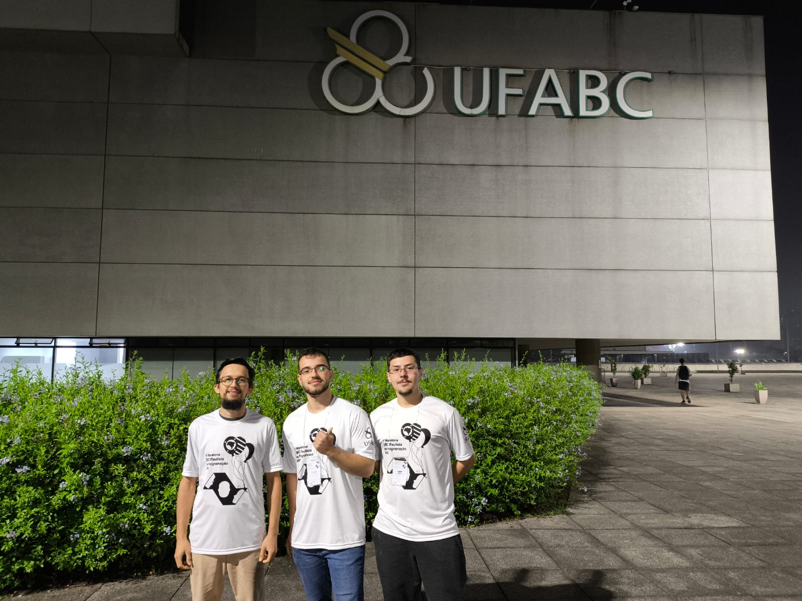

# Gabriel Viell Castilho

  

## Apresentação

Meu nome é Gabriel Viell Castilho, tenho 20 anos e sou estudante do curso de Análise e Desenvolvimento de Sistemas na FATEC São José dos Campos “Prof. Jessen Vidal”. Concluí o ensino médio técnico em Informática pelo SENAC São José dos Campos. Antes disso, iniciei o ensino médio técnico em Mecatrônica, no qual tive contato com a disciplina de informática, despertando maior interesse pela área de tecnologia, o que motivou minha transição para o curso técnico em Informática.

Minha motivação para ingressar na FATEC está relacionada ao interesse desenvolvido desde a infância pelo ambiente digital, por meio do contato com jogos, plataformas como YouTube e redes sociais. Esse contato despertou minha curiosidade em compreender o funcionamento das tecnologias, o que, aliado à formação técnica, consolidou minha decisão de seguir carreira na área de tecnologia, optando pela FATEC devido à qualidade do ensino e reconhecimento na região.

Além da formação acadêmica, participo de atividades extracurriculares voltadas à programação, como maratonas de programação, com destaque para a 1ª Maratona SBC Paulista de Programação, nas quais desenvolvo habilidades como raciocínio lógico, resolução de problemas e trabalho em equipe.

  

Até o momento, não possuo experiência profissional formal na área de tecnologia. No entanto, busco minha primeira oportunidade de estágio ou emprego, com o objetivo de aplicar na prática os conhecimentos adquiridos durante minha formação.

## Contatos

- **GitHub:** https://github.com/GabrielViellCastilho  
- **LinkedIn:** https://www.linkedin.com/in/gabriel-viell-castilho/  
- **Email:** gabrielviell@hotmail.com  

## Meus Principais Conhecimentos

Tenho maior foco em desenvolvimento back-end, principalmente na criação de APIs e integração com bancos de dados. Durante meus estudos e projetos acadêmicos, venho trabalhando com as seguintes tecnologias:

- **TypeScript (NestJS):** Desenvolvimento de APIs REST utilizando estrutura modular, criação de controllers e services, além de organização do projeto seguindo boas práticas.

- **Go (Golang):** Desenvolvimento de APIs simples, trabalhando com rotas HTTP, manipulação de dados e integração com banco de dados.

- **Banco de Dados (MySQL, PostgreSQL e MongoDB):** Criação de tabelas e coleções, consultas, relacionamentos e operações básicas de CRUD.

- **React (com TypeScript):** Desenvolvimento de interfaces web, consumo de APIs e organização de componentes.

- **Docker:** Utilização para subir ambientes de desenvolvimento, principalmente com banco de dados e aplicações back-end.

- **Git e GitHub:** Versionamento de código, uso de branches e organização de projetos.

- **Metodologias Ágeis (Scrum):** Experiência em projetos acadêmicos, participando da organização de tarefas e trabalho em equipe.

Ainda estou em processo de aprendizado e busco evoluir principalmente em desenvolvimento back-end, arquitetura de sistemas e boas práticas de programação.

## Projetos Desenvolvidos

| Semestre | Nome do Projeto | Tecnologias | Empresa Parceira | Descrição |
|----------|----------------|-------------|------------------|----------|
| [1º Semestre (2024-1)](./projetos/semestre1.md) | Scrum Academy | Flask, MySQL, HTML, CSS, JavaScript | Fatec-SJC | Aplicação web desenvolvida com o objetivo de ensinar e disseminar a metodologia ágil Scrum de forma acessível. |
| [2º Semestre (2024-2)](./projetos/semestre2.md) | Alplaca | Java, Hibernate, MySQL, Ollama (IA local) | Fatec-SJC | Sistema de leitura de placas veiculares utilizando IA para reconhecimento e extração de caracteres de placas veiculares, com processamento local dos dados. |
| [3º Semestre (2025-1)](./projetos/semestre3.md) | Alfalog | Python, Flask, MySQL, React, TypeScript | Fatec-SJC | Plataforma web para visualização e análise do desempenho dos estados brasileiros no comércio exterior, utilizando dados abertos governamentais. |
| [4º Semestre (2025-2)](./projetos/semestre4.md) | ClassiPy | Python, FastAPI, PostgreSQL, Ollama (IA local), React, TypeScript | TecSys | Sistema que realiza o upload de pedidos de compra em PDF e utiliza IA para extrair Part Numbers e sugerir automaticamente a classificação fiscal (NCM), descrição e fabricante dos produtos. |
| [5º Semestre (2026-1)](./projetos/semestre5.md) | ProDesk | TypeScript, React Native, NestJS, MongoDB | Pro4Tech | Aplicação mobile para gerenciamento de chamados, permitindo abertura, acompanhamento e comunicação entre usuários e suporte. |
| [6º Semestre (2026-2)](./projetos/semestre6.md) | Em definição | A definir | A definir | Projeto em fase de planejamento. |

