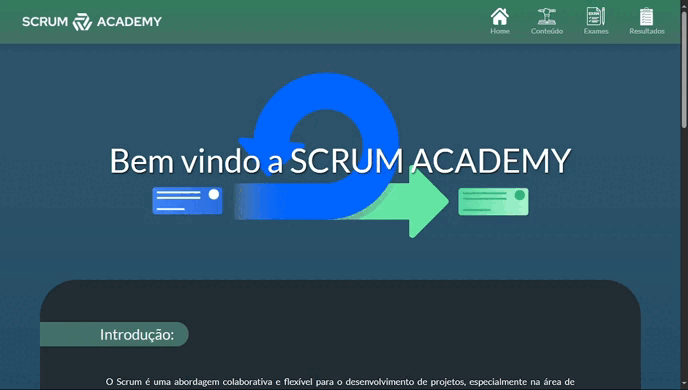
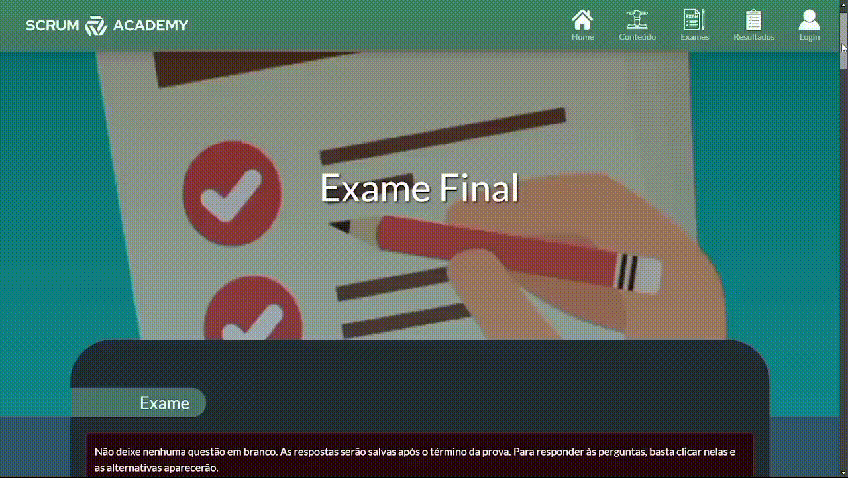
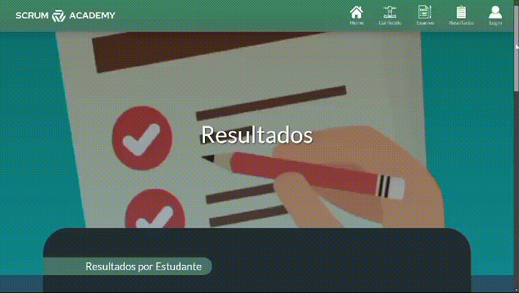

# Scrum Academy

## Empresa Parceira

O projeto foi desenvolvido em parceria com a FATEC São José dos Campos, tendo como responsável pelos requisitos o professor Antonio Egydio. A proposta foi conduzida dentro do ambiente acadêmico, simulando demandas reais de mercado, com foco na aplicação prática da metodologia ágil SCRUM durante o desenvolvimento do sistema.

## Problema

Durante o processo de ensino da metodologia SCRUM, foi identificado que muitos alunos apresentam dificuldade em compreender seus conceitos, eventos e artefatos de forma clara e estruturada. O conteúdo frequentemente está disperso em diferentes fontes, como slides, anotações e materiais externos, o que dificulta o aprendizado contínuo e a revisão dos conteúdos.

Além disso, a ausência de uma plataforma centralizada reduz o engajamento dos estudantes e limita a aplicação prática do conhecimento adquirido. Como consequência, muitos alunos acabam tendo dificuldades para relacionar a teoria com situações reais de utilização da metodologia ágil em projetos.

## Solução

A equipe desenvolveu uma aplicação web chamada Scrum Academy, com o objetivo de centralizar e organizar conteúdos relacionados à metodologia SCRUM em uma única plataforma acessível e intuitiva. O sistema foi criado para facilitar o aprendizado dos estudantes, reunindo materiais didáticos sobre papéis, eventos, artefatos e boas práticas da metodologia, reduzindo a necessidade de utilizar diferentes fontes de estudo.

Além dos conteúdos teóricos, a plataforma conta com funcionalidades interativas, como quizzes e exames, permitindo que os usuários pratiquem e reforcem o aprendizado de forma dinâmica. O sistema também foi desenvolvido com foco em usabilidade e responsividade, proporcionando uma experiência simples e acessível para diferentes dispositivos.

### Link do Repositório Git

https://github.com/Bug-Busters-F/scrum-academy.git

### Tecnologias Utilizadas

- **HTML:** utilizado na estruturação das páginas web.
- **CSS:** responsável pela estilização da interface.
- **JavaScript:** implementação de interatividade no front-end.
- **Bootstrap:** utilizado para padronização e responsividade da interface.
- **Python (Flask):** desenvolvimento do back-end e rotas da aplicação.
- **MySQL:** armazenamento e gerenciamento dos dados.
- **Git e GitHub:** versionamento de código e colaboração em equipe.
- **Figma:** prototipação das interfaces do sistema.
- **AWS:** hospedagem da aplicação.
- **Google Sheets:** organização de backlog e planejamento das sprints.

### Contribuições Pessoais

Atuei como desenvolvedor full-stack no projeto, trabalhando no desenvolvimento do back-end com Flask e na construção das interfaces utilizando HTML, CSS, Bootstrap e JavaScript. Fui responsável pela implementação do sistema de login com sessões integradas ao banco de dados MySQL, garantindo o controle de autenticação e acesso dos usuários.

Também desenvolvi melhorias na interface da aplicação, incluindo header, footer, páginas institucionais e ajustes de responsividade para diferentes tamanhos de tela. Além disso, implementei funcionalidades como Scrollspy e personalizei a navbar para exibir dinamicamente o nome do usuário logado no sistema.

Durante o projeto, participei da integração de gráficos conectados ao banco de dados, auxiliando na exibição dinâmica de informações na plataforma. Também atuei na organização do repositório utilizando Git e GitHub, realizando merges, resolução de conflitos e controle de versões durante as sprints do projeto.

### Hard Skills

- **HTML** — Faço com autonomia
- **CSS** — Faço com autonomia
- **JavaScript** — Faço com autonomia
- **Python (Flask)** — Faço com ajuda
- **MySQL** — Faço com autonomia
- **Git/GitHub** — Faço com autonomia
- **Bootstrap** — Faço com autonomia

### Soft Skills

- **Trabalho em equipe:** participei da implementação conjunta de funcionalidades relacionadas à autenticação e interface visual, dividindo tarefas com outros integrantes e auxiliando na integração entre front-end e back-end durante as sprints.

- **Adaptabilidade:** precisei realizar ajustes frequentes na interface da aplicação, como correções de responsividade, alterações no header e footer e melhorias visuais solicitadas ao longo do desenvolvimento do projeto.

- **Resolução de problemas:** identifiquei e corrigi problemas relacionados à exibição de informações do usuário após o login, além de resolver bugs visuais e inconsistências em componentes da interface.

<strong>Demonstração da Evolução do Projeto</strong>

### Sprint 1

  

### Sprint 2

  

### Sprint 3

  

### Sprint 4

  

