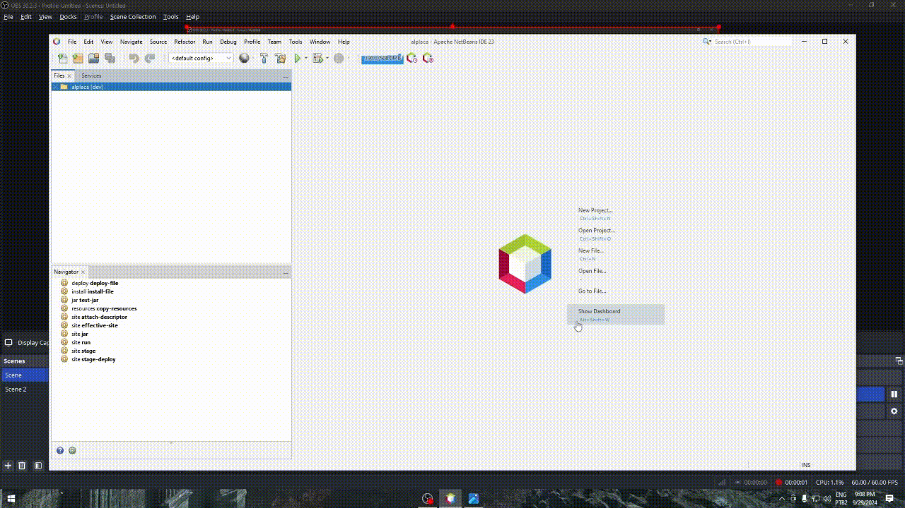
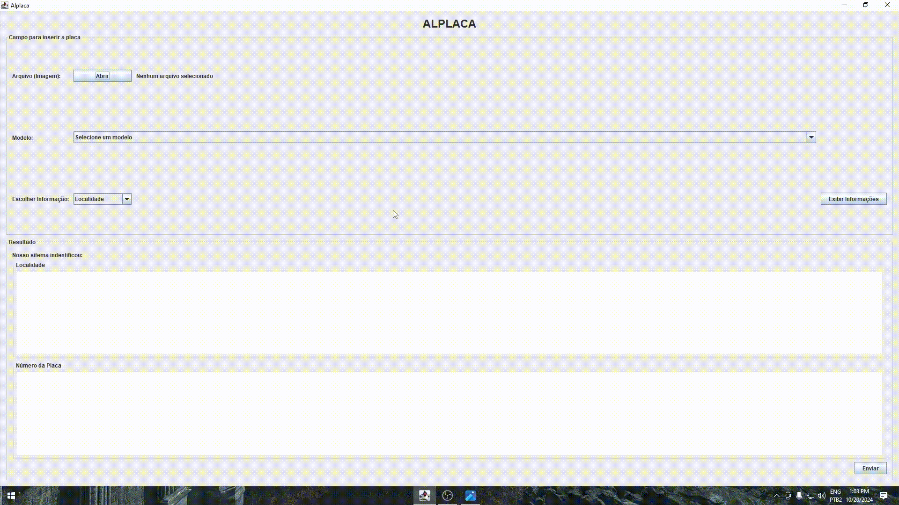
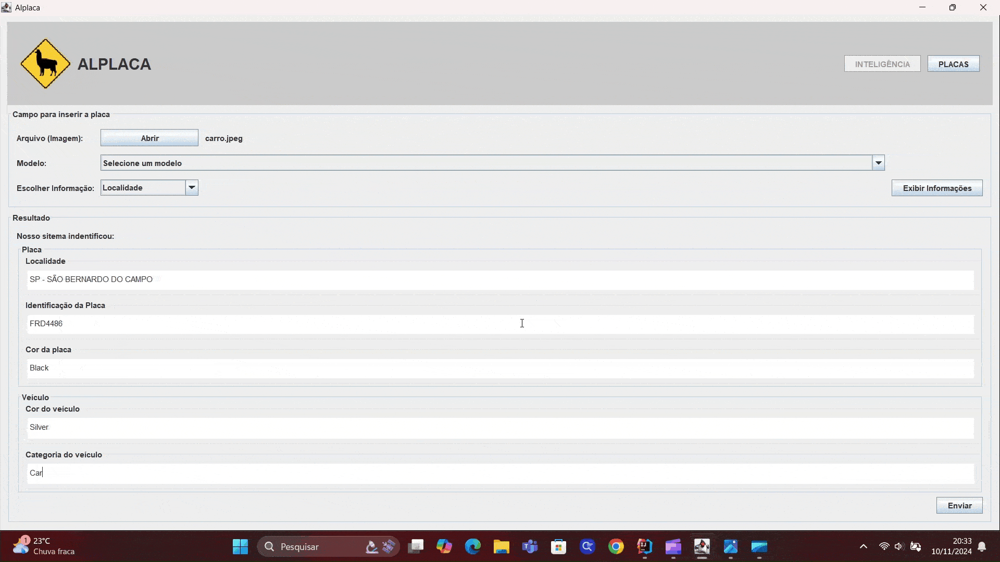
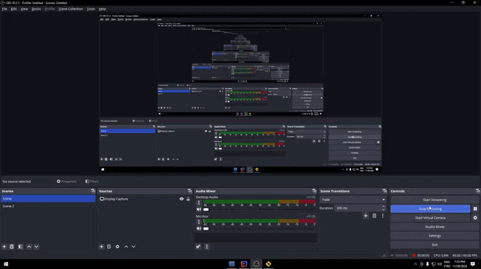

# Alplaca

## Empresa Parceira

O projeto foi desenvolvido em parceria com a FATEC São José dos Campos, tendo como responsável pelos requisitos o professor Giuliano Bertoti. A proposta foi conduzida em ambiente acadêmico, simulando um cenário real de desenvolvimento de software, com foco na construção de uma aplicação desktop integrada a banco de dados para gerenciamento de informações de veículos e placas obtidos através de IA.

## Problema

Em processos que dependem de análise visual, como leitura e identificação de placas de veículos, muitas soluções utilizam serviços de IA terceirizados e conectados à internet. Isso pode gerar preocupações relacionadas à segurança e privacidade dos dados, principalmente quando informações sensíveis precisam ser enviadas para servidores externos para processamento.

Além disso, a dependência de serviços externos pode limitar o funcionamento da aplicação em ambientes sem conexão com a internet e aumentar custos com utilização de APIs. Também foi identificado que a manipulação manual dessas informações torna o processo mais lento, sujeito a erros e menos eficiente para tarefas que poderiam ser automatizadas com visão computacional.

## Solução

A equipe desenvolveu uma aplicação desktop utilizando Java com interface gráfica integrada a um banco de dados MySQL e a modelos de IA executados localmente por meio do Ollama. O sistema foi criado para automatizar tarefas que dependem de visão computacional, como leitura e identificação de placas de veículos, sem necessidade de utilizar serviços externos na nuvem.

A utilização de IA local permitiu maior segurança no processamento dos dados, já que as informações permanecem no ambiente da aplicação sem envio para terceiros. Além disso, o sistema possibilita realizar operações de cadastro, consulta, atualização e exclusão de registros, além de pesquisa de placas, navegação entre registros e armazenamento de imagens associadas aos veículos.

### Link do Repositório Git

https://github.com/Bug-Busters-F/alplaca.git

### Tecnologias Utilizadas

- **Java:** desenvolvimento da aplicação desktop e regras de negócio
- **MySQL:** armazenamento e gerenciamento dos dados
- **Hibernate:** mapeamento objeto-relacional (ORM)
- **Ollama:** utilização de modelos de IA no projeto
- **Git e GitHub:** versionamento e colaboração em equipe
- **IntelliJ / NetBeans:** desenvolvimento da aplicação
- **Google Sheets:** organização do backlog e planejamento das sprints

### Contribuições Pessoais

Atuei como desenvolvedor no projeto, trabalhando principalmente na integração entre a interface gráfica e o banco de dados utilizando Java, Hibernate e MySQL. Implementei funcionalidades de inserção e consulta de dados diretamente pela interface da aplicação, permitindo que os usuários realizassem operações no banco sem necessidade de comandos manuais.

Também desenvolvi funcionalidades de atualização e exclusão de registros, garantindo que as alterações fossem refletidas corretamente na interface em tempo real. Além disso, implementei funcionalidades de pesquisa de placas e navegação entre registros para facilitar a visualização e localização das informações cadastradas.

Participei ainda da implementação do salvamento de imagens vinculadas aos registros dos veículos, tratamento de mensagens de erro e correção de bugs relacionados à atualização de tabelas e exibição de dados. Durante o desenvolvimento, também contribui com a organização do repositório utilizando Git e GitHub, realizando merges, resolução de conflitos e versionamento do projeto.

### Hard Skills

- **Java** — Faço com autonomia
- **MySQL** — Faço com autonomia
- **Hibernate** — Faço com autonomia
- **Git/GitHub** — Faço com autonomia
- **Interface Gráfica em Java** — Faço com ajuda
- **Ollama** — Faço com ajuda

### Soft Skills

- **Comunicação:** durante a implementação das funcionalidades de atualização de registros, alinhei com o time como os dados deveriam ser exibidos na interface após alterações no banco, evitando inconsistências visuais na tabela da aplicação.

- **Trabalho em equipe:** participei do desenvolvimento das funcionalidades de CRUD junto aos outros integrantes, dividindo tarefas e auxiliando na integração entre interface gráfica e persistência de dados.

<strong>Demonstração da Evolução do Projeto</strong>

### Sprint 1

  

### Sprint 2

  

### Sprint 3

  

### Sprint 4

  

