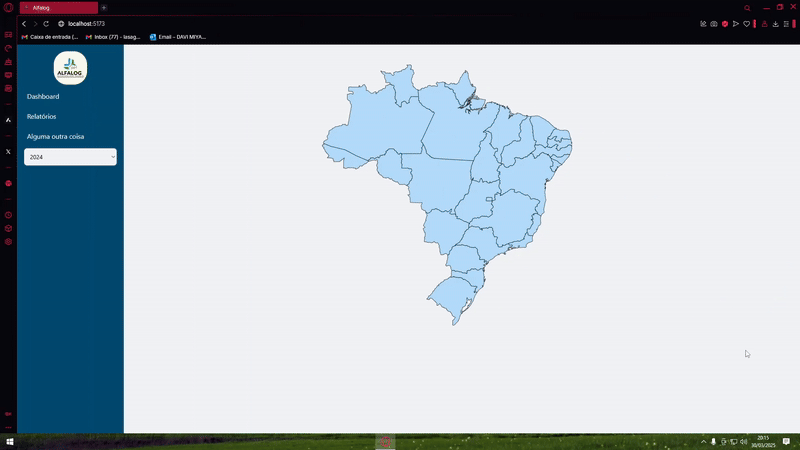
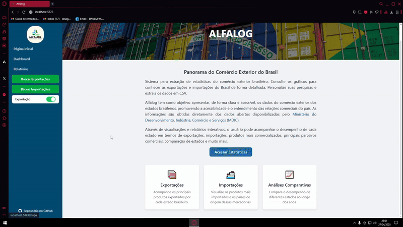
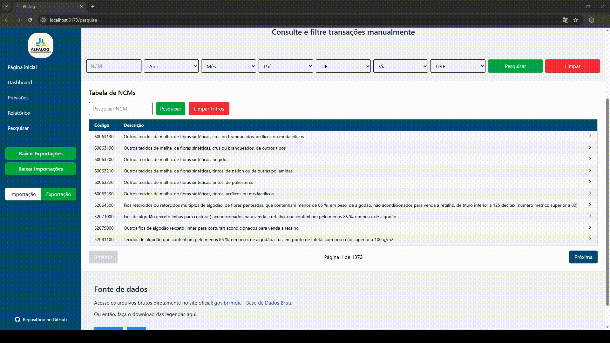

# Alfalog

## Empresa Parceira

O projeto foi desenvolvido em parceria com a FATEC São José dos Campos, tendo como responsável pelos requisitos o professor Marcus Nascimento. A proposta foi conduzida em ambiente acadêmico, simulando um cenário real de mercado, com foco na análise de dados de comércio exterior e no desenvolvimento de uma plataforma web para apoio à tomada de decisão.

## Problema

A análise de dados de comércio exterior no Brasil é dificultada pela grande quantidade de informações disponibilizadas em bases públicas, como os dados do Comex Stat. Normalmente, essas informações são fornecidas em arquivos extensos e pouco organizados para análise visual, dificultando a interpretação dos dados e a identificação de padrões relevantes relacionados a exportações e importações.

Além disso, a ausência de ferramentas visuais e interativas torna o processo de análise mais lento e complexo, dificultando a comparação entre estados, municípios, NCMs, vias de transporte e URFs. A manipulação manual desses dados também aumenta a chance de inconsistências e dificulta a geração de informações estratégicas para apoio à tomada de decisão.

## Solução

A equipe desenvolveu uma aplicação web para visualização e análise de dados de comércio exterior, utilizando gráficos interativos, tabelas dinâmicas e dashboards analíticos. A plataforma permite que usuários explorem informações relacionadas a exportações e importações de forma mais intuitiva, facilitando a interpretação dos dados e a identificação de tendências.

O sistema também conta com filtros para pesquisa por NCM, visualização de informações por estados, vias de transporte e URFs, além de funcionalidades de previsão de tendências utilizando inteligência analítica. A aplicação foi construída com foco em acessibilidade, organização visual e apoio à tomada de decisão baseada em dados.

### Link do Repositório Git

https://github.com/Bug-Busters-F/alfalog.git

### Tecnologias Utilizadas

- **React / TypeScript:** desenvolvimento do front-end da aplicação
- **Python / Flask:** desenvolvimento da API
- **MySQL:** armazenamento e gerenciamento dos dados
- **ApexCharts:** criação de gráficos interativos
- **Docker:** conteinerização da aplicação
- **AWS:** deploy e hospedagem da aplicação
- **Git e GitHub:** versionamento e colaboração em equipe
- **Google Colab:** tratamento, limpeza e análise dos dados
- **Tailwind CSS:** estilização da interface

### Contribuições Pessoais

Atuei como desenvolvedor no projeto, trabalhando principalmente na integração entre front-end e API utilizando React, TypeScript. Implementei a conexão entre tabelas, gráficos e os dados retornados pela API, permitindo que as informações fossem exibidas dinamicamente na interface da aplicação.

Também desenvolvi gráficos interativos utilizando ApexCharts, incluindo visualizações relacionadas a NCMs, vias de transporte, URFs e balança comercial. Além disso, participei da implementação de funcionalidades de previsão de tendências, integrando gráficos que exibem projeções baseadas em dados históricos tratados pela aplicação.

Durante o desenvolvimento, realizei ajustes em rotas da API, correções de bugs relacionados à exibição de dados e adequações em parâmetros de requisição utilizados nos gráficos e tabelas. Também participei da organização do projeto utilizando Git e GitHub, realizando merges, resolução de conflitos e manutenção da estrutura do código durante as sprints.

### Hard Skills

- **React / TypeScript** — Faço com autonomia
- **Python (Flask)** — Faço com ajuda
- **MySQL** — Faço com autonomia
- **Git/GitHub** — Faço com autonomia
- **ApexCharts** — Faço com ajuda
- **Docker** — Faço com autonomia
- **Tailwind CSS** — Faço com autonomia

### Soft Skills

- **Comunicação:** durante a integração dos gráficos com a API, alinhei com o time como os dados deveriam ser estruturados para facilitar a renderização das informações no front-end e evitar inconsistências nas visualizações.

- **Adaptabilidade:** precisei ajustar rapidamente gráficos, tabelas e parâmetros de requisição após mudanças nas rotas da API e na estrutura dos dados utilizados pela aplicação.

<strong>Demonstração da Evolução do Projeto</strong>

### Sprint 1

  

### Sprint 2

  

### Sprint 3

  

