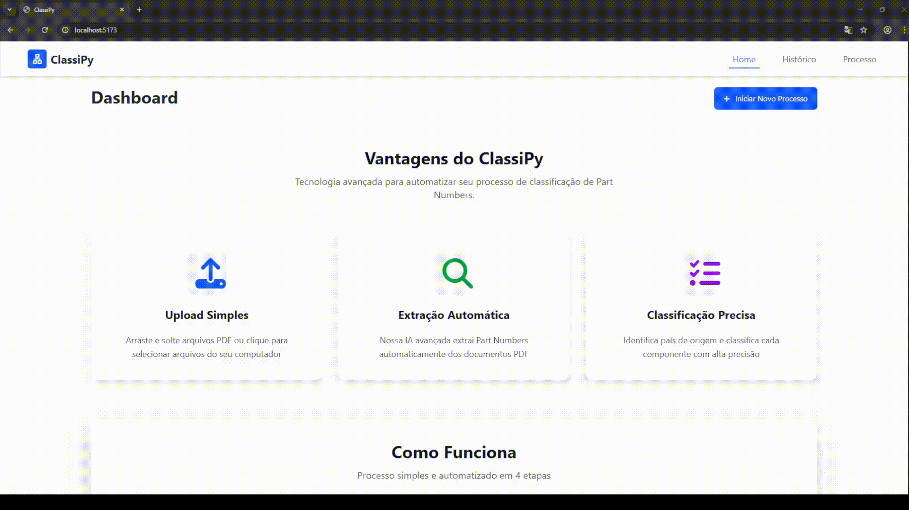
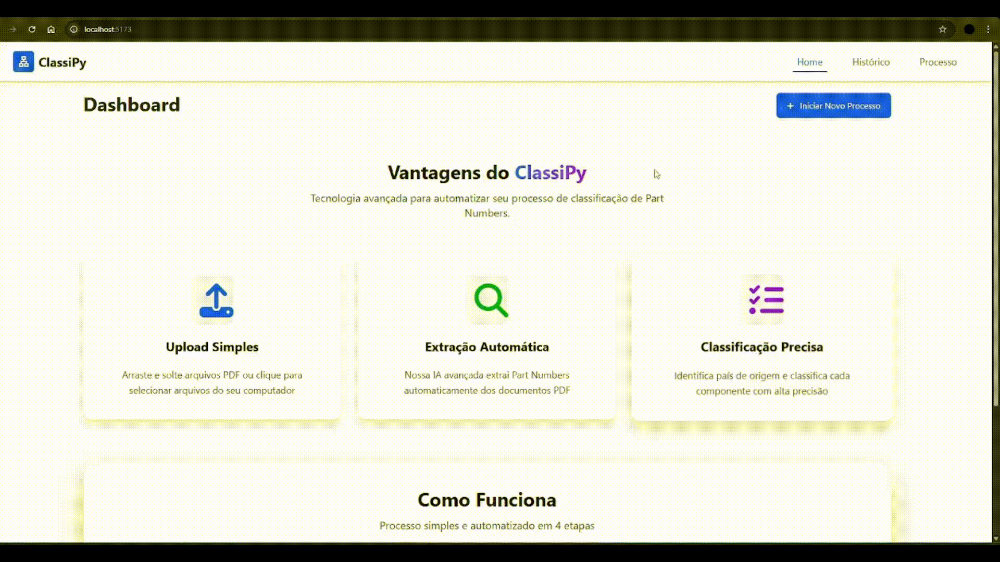
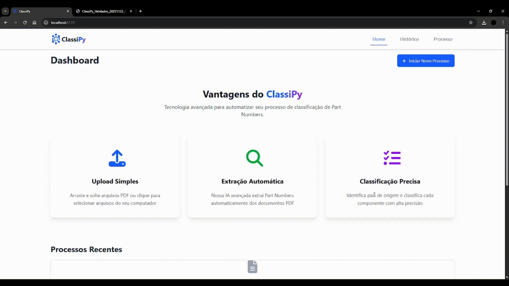

# ClassiPy

## Empresa Parceira

O projeto foi desenvolvido em parceria com a empresa TecSys, com foco em um cenário real da área de importação. A proposta envolveu a criação de uma solução para automatizar processos relacionados ao registro de importação, reduzindo erros e aumentando a eficiência operacional.

## Problema

O processo de elaboração de registros de importação é complexo e altamente suscetível a erros, pois exige o preenchimento manual de diversas informações como Part Number, NCM, fabricante e origem do produto. Essas informações precisam ser consistentes e detalhadas, já que qualquer inconsistência pode gerar problemas com a Receita Federal.

Além disso, a análise manual de documentos como pedidos de compra em PDF torna o processo lento e repetitivo, aumentando o risco de erros humanos e retrabalho, além de impactar diretamente os prazos das operações de importação.

## Solução

A equipe desenvolveu uma aplicação web chamada ClassiPy, que utiliza Inteligência Artificial para automatizar o processo de classificação de produtos para importação. O sistema permite o upload de arquivos PDF, extrai automaticamente os Part Numbers e sugere informações como NCM, descrição do produto, fabricante e origem.

A solução também oferece visualização organizada dos dados, possibilidade de edição manual, histórico de consultas e exportação dos resultados, tornando o processo mais rápido, confiável e eficiente.

### Tecnologias Utilizadas

- React / TypeScript: desenvolvimento do front-end
- Tailwind CSS: estilização da interface
- Python / FastAPI: construção da API
- PostgreSQL: armazenamento dos dados
- Docker: conteinerização da aplicação
- Ollama: integração com modelos de IA
- ChromaDB: banco vetorial para busca inteligente
- Git e GitHub: versionamento e colaboração
- Jira: gestão do projeto

### Contribuições Pessoais

Atuei como desenvolvedor no projeto, com foco no back-end e na integração com Inteligência Artificial. Implementei a conexão entre o banco de dados e o modelo de IA utilizando Ollama, permitindo que os dados fossem utilizados no processo de classificação dos produtos.

Trabalhei na implementação de um banco vetorial utilizando ChromaDB, contribuindo para melhorar a busca e a precisão das informações retornadas pelo sistema. Também desenvolvi funcionalidades relacionadas ao histórico de consultas, incluindo persistência de dados e paginação para melhor navegação.

Além disso, implementei rotas específicas na API, como recuperação de Part Numbers recentes, e realizei correções importantes, como leitura completa de arquivos PDF e tratamento de dados em formato JSON. Participei ativamente da organização do projeto com Git, realizando merges, resolução de conflitos e melhorias na estrutura do código.

### Hard Skills

- Python (FastAPI) — faço com autonomia
- React / TypeScript — faço com autonomia
- PostgreSQL — faço com autonomia
- Docker — faço com autonomia
- Integração com IA (Ollama) — faço com ajuda
- Banco vetorial (ChromaDB) — faço com ajuda
- Git/GitHub — faço com autonomia

### Soft Skills

- **Comunicação:** durante a integração com a IA, ajudei a alinhar com o time como os dados deveriam ser estruturados para melhorar a resposta do modelo.

- **Trabalho em equipe:** colaborei na implementação de funcionalidades como histórico, rotas e integração com banco de dados, garantindo que as partes funcionassem de forma integrada.

- **Adaptabilidade:** precisei me adaptar ao uso de novas tecnologias como banco vetorial e integração com IA, aprendendo e aplicando rapidamente no projeto.

- **Resolução de problemas:** identifiquei e corrigi problemas como leitura incompleta de PDFs e inconsistências no processamento de dados JSON.

### Demonstração da Evolução do Projeto

#### **Sprint 1**

  

#### **Sprint 2**

  

#### **Sprint 3**

  

